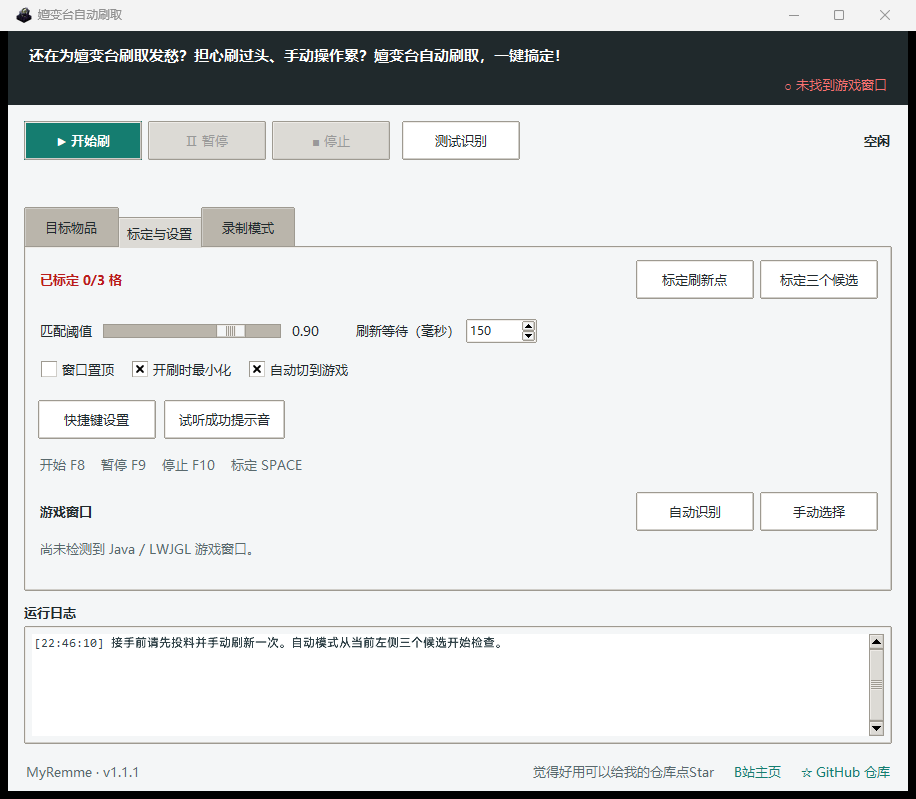
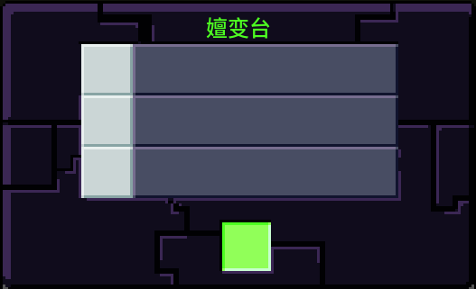
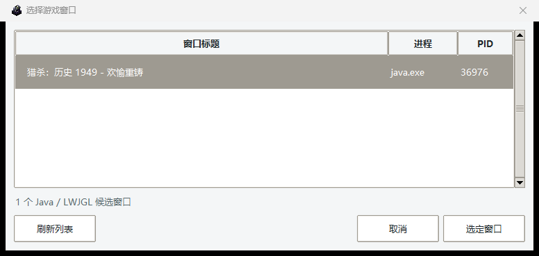

# 嬗变台自动刷取

Windows 桌面工具，用截图和 RGB 模板匹配识别 Minecraft Alex’s Mobs 嬗变台左侧的三个候选物品。任意目标出现后，选择对应候选并停止。

[下载 Windows 便携版](https://github.com/MyRemme/mc-transmute-bot/releases/latest) · [MyRemme 的 B站主页](https://space.bilibili.com/1746890498)


## 一键运行

1. 在 [Releases](https://github.com/MyRemme/mc-transmute-bot/releases/latest) 下载 `mc-transmute-bot-1.1.3-windows-x64.zip`。
2. 将压缩包完整解压到有写入权限的文件夹，双击 `嬗变台自动刷取.exe`。
3. 打开 Minecraft，按下面的说明选择窗口、添加目标并标定候选。

便携版已包含 Python 运行时、识别依赖和成功提示音。请保留 EXE 旁的 `_internal` 文件夹。运行时会在 EXE 同目录保存 `config.json`、`targets/`、`macros/` 等本地数据。升级时将新版程序文件完整覆盖到原文件夹，已有本地配置与目标图可继续使用。遇到启动错误时会弹窗，并尝试在同目录保存 `startup-error.log`。

## 源码运行

需要 Windows 10/11、Python 3.10 或更高版本。安装 Python 时启用 Add Python to PATH。

```powershell
python -m pip install -r requirements.txt
python gui.py
```

也可双击 `gui.bat`。启动出错时，控制台会保留错误信息。

## 自动刷取

1. 在游戏里投入物品，手动转化刷新一次，保持嬗变台界面打开。
2. 打开“标定与设置”，点“自动识别”或“手动选择”，确认选中的游戏窗口标题及进程。
3. 点“标定三个候选”。从上到下悬停左侧三个候选图标，按标定快捷键，默认是 Space，满三个自动保存。
4. 在“目标物品”添加图片，可一次选择多张，也可通过“截取目标”或“点选目标”从选定的游戏窗口获取。每张图片只截一个物品，物品数量为 1，图标上不能有堆叠数量文字。
5. 点“测试识别”查看当前三格分数。确认后点“开始刷”，或按开始快捷键 F8。
6. 任一目标命中后程序点击对应候选，播放提示音并停止。需要中途结束时按停止快捷键，默认是 F10。

每轮先检查当前三个候选。任一候选匹配目标时，普通左键选择并停止。三格均无目标时，默认选择第一行候选，完成转化并重抽。底部绿色槽位显示当前投入或转化后的物品。

“标定刷新点”可覆盖默认刷新位置，适用于布局经过修改的整合包。目标库中的任意图片命中都能结束自动刷取。

目标列表支持滚动、多选移除和彩色预览。模板会适配多种 GUI 缩放，改变 GUI 布局后应重新标定。

选中目标图片后点击“预览遮罩”，或双击目标行，查看原图、参与匹配的像素和遮罩。遮罩中白色表示保留，红色表示排除，棋盘格表示透明区域。多选后可在预览窗口切换目标，也可切换查看不同尺寸的模板，并查看保留像素数量及比例。

检查物品是否完整保留、槽位背景和边框是否被排除。若出现误删或背景残留，重新截取目标图后再次预览。预览显示模板的像素遮罩，当前游戏候选的命中情况可通过“测试识别”查看。



## 截图示例

使用“录制模式 → 截图框选”选择嬗变台实例区域时，按图 1 框住嬗变台面板，包含左侧三个候选和底部绿色槽位。

**图 1 · 嬗变台实例的截图范围**



添加目标物品时，参照图 3 或图 4 截取单个物品图标。灰色槽位背景和绿色槽位背景都可以。先将物品拆成数量为 1 的单个物品，再截取，图片中不能出现 `2`、`16`、`64` 等堆叠数量。

| 图 3 · 灰色背景的单个目标 | 图 4 · 绿色背景的单个目标 |
| --- | --- |
|  |  |

自动模式仍需从上到下标定左侧三个候选中心。底部绿色槽位用于投入或显示转化后的物品。

## 选择游戏窗口

自动识别依据 Java 进程名、LWJGL / GLFW 窗口类和标题关键字排序。整合包自定义标题也能作为候选。

“自动识别”找到唯一候选时直接选定，存在多个候选时打开列表。“手动选择”始终打开列表，显示窗口标题、进程名和 PID，可双击候选或点“选定窗口”确认。



选定后截图、坐标换算、前台切换和刷取使用同一个窗口。程序校验窗口句柄、PID、进程创建时间、进程名和窗口类。游戏关闭或重启后需要重新选择。窗口标题改变时可以继续使用同一窗口。切换到另一个窗口后需要重新标定三个候选。

主窗口顶部和设置页显示当前目标窗口。列表为空时，先打开游戏，再点“刷新列表”。

## 快捷键

在“标定与设置 → 快捷键设置”中直接输入快捷键，或点“录入”后按下并松开所需按键。支持字母、数字、功能键、方向键、鼠标按钮和组合键。加号键可用 `plus` 表示。

| 动作 | 默认快捷键 |
| --- | --- |
| 开始刷取 | F8 |
| 暂停 / 继续 | F9 |
| 停止 | F10 |
| 开始录制 | F6 |
| 录制打点 | F11 |
| 结束录制 | F7 |
| 标定打点 | Space |

设置保存后立即生效。已有本机配置中的按键会继续使用，包括旧版本设置的停止键。设置窗口打开期间暂停运行快捷键响应，方便录入。

## 成功提示音

成功选择后异步播放 `assets/success.wav`。该文件由用户提供的 Ciallo 音频转换成 PCM WAV，声音内容保持原样。“标定与设置”提供试听按钮。

## 识别与性能

匹配使用 RGB 三通道和物品遮罩，比较物品颜色与图案。背景和槽位边框通过遮罩剔除。模板频谱缓存、图像频谱复用及刷新画面复用减少重复计算，短时窗口句柄缓存减少重复枚举。

v1.1.2 修正了向内偏移的绿色槽位边框被算作物品的问题。三个目标同时启用的真实游戏测试中，第 37 轮命中一个目标，匹配分数 1.000，选择后底部得到该目标并停止。绿色目标在同一游戏画面中的匹配分数由 0.739 提升到 0.997。

图片数量没有硬上限，耗时随模板数量和缩放变体数量增加。同机使用保存的三个 96×96 候选裁图测量，单模板纯匹配中位耗时约 25.9 毫秒，4 个模板约 87.6 毫秒。实际每轮还包含窗口检查、截图、点击和游戏刷新等待，耗时随机器和素材变化。

“刷新等待”默认 150 毫秒，可在设置中调整。录制回放倍速仅用于“录制模式”。

## 截图范围

程序只读取 Minecraft 客户区及其中的候选区域。截图区域超出游戏窗口、游戏最小化或被其他窗口遮挡时停止。调试截图保存在本地 `debug/`，运行配置保存在本地 `config.json`。

## 录制模式

可在“录制模式”录制自己的流程，使用开始录制、结果打点和结束录制快捷键。打点前的动作作为 `spin`，打点后的动作作为 `clear`。关闭自动模式后可回放已录制流程。

录制控制快捷键会从回放事件中剔除。录制动作文件保存在本地 `macros/`。

## 测试

```powershell
python test_offline.py
python mcb.py selftest
```

离线回归覆盖 RGB 匹配、遮罩、多尺寸、FFT 数值一致性、三个候选命中与停止、快捷键组合和防连发、提示音调用、窗口关闭及句柄复用。测试运行时生成合成图像，运行测试不点击游戏。

## 文件

| 文件 | 作用 |
| --- | --- |
| `gui.py` | Tkinter 图形界面 |
| `mcb.py` | 截图、识别、自动循环和录制回放 |
| `hotkeys.py` | 键盘与鼠标组合快捷键 |
| `assets/success.wav` | 成功提示音 |
| `assets/app.png` / `assets/app.ico` | 程序窗口与 EXE 图标 |
| `requirements.txt` | Python 依赖 |
| `MCTransmuteBot.spec` | PyInstaller Windows 便携版构建配置 |
| `build-release.ps1` | 构建 EXE、ZIP 和 SHA-256 校验文件 |
| `test_offline.py` | 使用合成图像的离线回归测试 |

本机的 `config.json`、`targets/`、`macros/` 和调试截图通过 `.gitignore` 保留在本地。首次启动会使用默认配置，添加自己的目标图片并标定后即可运行。

## 自行打包

在 Windows 上安装依赖后运行，构建结果位于 `dist/`。

```powershell
python -m pip install -r requirements.txt pyinstaller
powershell -ExecutionPolicy Bypass -File .\build-release.ps1
```

## 作者

MyRemme · [GitHub 仓库](https://github.com/MyRemme/mc-transmute-bot) · [B站主页](https://space.bilibili.com/1746890498)

觉得好用可以给我的仓库点 Star。[GitHub 仓库](https://github.com/MyRemme/mc-transmute-bot)
