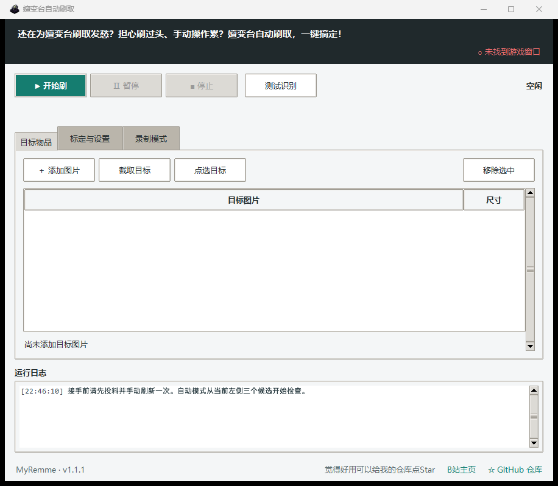

# MC 嬗变台自动刷

Windows 桌面工具，用截图和 RGB 模板匹配识别 Minecraft Alex’s Mobs 嬗变台左侧的三个候选物品。任意目标出现后，选择对应候选并停止。



## 安装与启动

需要 Windows 10/11、Python 3.10 或更高版本。安装 Python 时启用 Add Python to PATH。

```powershell
python -m pip install -r requirements.txt
python gui.py
```

也可双击 `gui.bat`。启动出错时，控制台会保留错误信息。

## 自动刷取

1. 在游戏里投入物品，手动转化刷新一次，保持嬗变台界面打开。
2. 打开“标定与设置”，点“标定三个候选”。从上到下悬停三个候选图标，按标定快捷键，满三个自动保存。
3. 在“目标物品”添加图片，可一次选择多张，也可直接从游戏窗口截取。
4. 点“测试识别”查看当前三格分数，再点“开始刷”。

每轮先检查当前三个候选。任一候选匹配目标时，普通左键选择并停止。三格均无目标时，默认选择第一行候选，完成转化并重抽。底部绿色槽位显示当前投入或转化后的物品。

“标定刷新点”可覆盖默认刷新位置，适用于布局经过修改的整合包。目标库中的任意图片命中都能结束自动刷取。

目标列表支持滚动、多选移除和彩色预览。模板会适配多种 GUI 缩放，改变 GUI 布局后应重新标定。

## 快捷键

在“标定与设置 → 快捷键设置”中直接输入快捷键，或点“录入”后按下并松开所需按键。支持字母、数字、功能键、方向键、鼠标按钮和组合键，例如 `ctrl+shift+p`、`alt+mouse_x1`、`ctrl+plus`。

| 动作 | 默认快捷键 |
| --- | --- |
| 开始刷取 | F8 |
| 暂停 / 继续 | F9 |
| 停止 | F10 |
| 开始录制 | F6 |
| 录制打点 | F11 |
| 结束录制 | F7 |
| 标定打点 | Space |

设置保存后立即生效。已有本机配置中的按键会继续使用，包括旧版本设置的停止键。设置窗口打开期间暂停运行快捷键响应，方便录入。

## 成功提示音

成功选择后异步播放 `assets/success.wav`。该文件由用户提供的 Ciallo 音频转换成 PCM WAV，声音内容保持原样。“标定与设置”提供试听按钮。

## 识别与性能

匹配使用 RGB 三通道和物品遮罩，比较物品颜色与图案。背景和槽位边框通过遮罩剔除。模板频谱缓存、图像频谱复用及刷新画面复用减少重复计算，短时窗口句柄缓存减少重复枚举。

图片数量没有硬上限，耗时随模板数量和缩放变体数量增加。此前同机离线测量，三格纯匹配单模板约 20～30 毫秒，10 个模板约 180～210 毫秒。实际每轮还包含窗口检查、截图、点击和游戏刷新等待。

“刷新等待”默认 150 毫秒，可在设置中调整。录制回放倍速仅用于“录制模式”。

## 截图范围

程序只读取 Minecraft 客户区及其中的候选区域。截图区域超出游戏窗口、游戏最小化或被其他窗口遮挡时停止。调试截图保存在本地 `docs/`，运行配置保存在本地 `config.json`。

## 录制模式

可在“录制模式”录制自己的流程，使用开始录制、结果打点和结束录制快捷键。打点前的动作作为 `spin`，打点后的动作作为 `clear`。关闭自动模式后可回放已录制流程。

录制控制快捷键会从回放事件中剔除。录制动作文件保存在本地 `macros/`。

## 测试

```powershell
python test_offline.py
python mcb.py selftest
```

离线回归覆盖 RGB 匹配、遮罩、多尺寸、FFT 数值一致性、三个候选命中与停止、快捷键组合和防连发、提示音调用。测试使用 `tests/fixtures/` 中裁好的游戏界面，运行测试不点击游戏。

此前真实游戏验证中，目标在第 72 轮出现在第二格，分数 0.973。选择后底部获得 64 个目标并停止。相应裁图已用于回归测试。

## 文件

| 文件 | 作用 |
| --- | --- |
| `gui.py` | Tkinter 图形界面 |
| `mcb.py` | 截图、识别、自动循环和录制回放 |
| `hotkeys.py` | 键盘与鼠标组合快捷键 |
| `assets/success.wav` | 成功提示音 |
| `requirements.txt` | Python 依赖 |
| `tests/fixtures/` | 裁好的识别回归素材 |

本机的 `config.json`、`targets/`、`macros/` 和调试截图通过 `.gitignore` 保留在本地。首次启动会使用默认配置，添加自己的目标图片并标定后即可运行。
